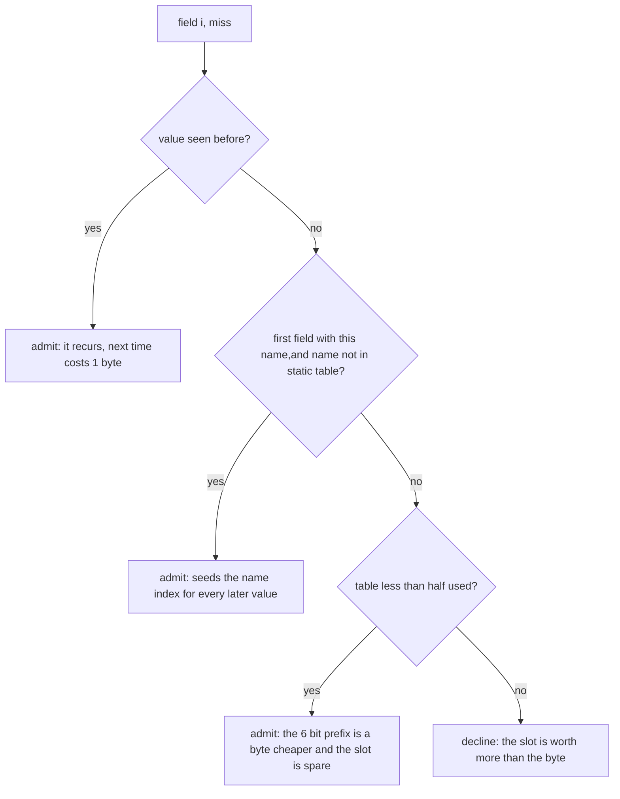
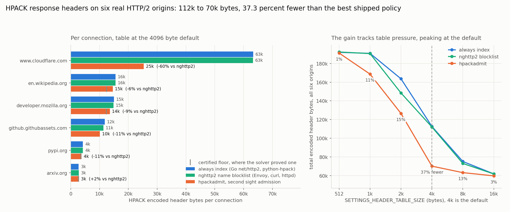

# hpackadmit

Chooses which HTTP/2 response headers are worth a slot in the HPACK dynamic
table, and proves how much the choice is worth.

## The problem

HPACK (RFC 7541) gives an encoder a 4096 byte dynamic table and exactly one
degree of freedom per header field: insert it, or do not. Eviction is not a
choice. The table is strict FIFO, so inserting one field pushes out the oldest
ones, whatever they were. The encoder cannot pin, refresh or reorder anything.

That one decision is almost always made by not making it. Go's `net/http2`
inserts every field that is not marked sensitive and fits:

```go
func (e *Encoder) shouldIndex(f HeaderField) bool {
    return !f.Sensitive && f.Size() <= e.dynTab.maxSize
}
```

python-hpack does the same, and says so in `Encoder.add`:

```
# Indexed literal. We are going to add header to the
# header table unconditionally. It is a future todo to
# filter out headers which are known to be ineffective for
# indexing since they just take space in the table and
# pushed out other valuable headers.
```

nghttp2, and so Envoy, curl and Apache httpd, is the one that tries: it keeps
a hand written list of names out of the table (`:path`, `age`,
`content-length`, `etag`, `if-modified-since`, `if-none-match`, `location`,
`set-cookie`) and refuses any entry larger than three quarters of the table.

On real traffic none of that is enough, because the headers that churn are
server specific. A Cloudflare response carries a fresh `cf-ray` every time,
GitHub stamps `x-github-request-id`, Wikipedia sends `x-request-id` and
`server-timing`, and every one of them sends a `date` that changes each
second. Inserting those is pure loss: the value never recurs, and each
insertion evicts something that would have recurred. Across the six
connections captured here, 397,472 bytes of entries pass through a 4096 byte
table. The table turns over 43 times on one connection. Nothing useful
survives.

## What this does

Three things, in one small package.

1. **An exact cost model** of HPACK encoding under an admission policy, which
   reproduces hpack 4.1.0 byte for byte on every policy and trace in the test
   suite.
2. **An exact admission optimum**, as a mixed integer program solved by HiGHS.
   It answers what no heuristic can: how many bytes are actually on the table.
   The solver's dual bound is a certified floor under every admission policy.
3. **An online policy, `second_sight`**, that needs no sight of the future and
   captures most of that gap. It is about twenty lines and drops in wherever
   an encoder already has a per field indexing flag (Go's `Sensitive`,
   nghttp2's `NGHTTP2_NV_FLAG_NO_INDEX`, hpack's `sensitive`).

The policy is three rules, all stated in terms of half the table:

- a value seen before earns a slot, because it has shown that it recurs and
  can then go out as a single byte;
- the first field carrying a name that is not in the static table earns a slot,
  because every later field with that name can then index the name instead of
  spelling it out, whatever its value;
- anything else is admitted only while the table is less than half used.

## Why it is interesting

**The control surface is admission only, so Belady does not apply.** Offline
optimal caching is easy when you may evict whatever you like: evict the item
used furthest in the future. HPACK does not let you. Eviction order is fixed by
the protocol and the only lever is which items ever enter. That is a different
problem, and the textbook answer to the easier one is no guide.

**The obvious clairvoyant policy is not optimal, and sometimes loses.** Admit
only what gets used again later, with full knowledge of the connection, and you
do worse than `second_sight` does online (71,331 bytes against 70,226), and
worse than inserting everything on one of the six origins. Two reasons, both
structural. An unrepeated value still leaves its *name* in the table, which
every later field with that name can index. And RFC 7541 charges you a byte to
decline: literal with incremental indexing carries a 6 bit index prefix
(section 6.2.1) while literal without indexing and never indexed carry only 4
bits (6.2.2, 6.2.3), so declining a field whose name index is 15 or more, which
is most of the static table, costs an extra byte right there. Admission is not
free in either direction.

**FIFO liveness is a window sum, which is what makes the exact solve
possible.** The state of the table looks exponential: which entries are in it.
It is not. An entry admitted at field `j` is still there at field `i` exactly
when the admitted bytes in `[j, i)` fit:

```
C_i = sum of s_k over admitted k < i        live(j, i)  iff  C_i - C_j <= B
```

So liveness is a window sum on one monotone clock, and what the program carries
per key is that sum, capped: `G_i = min(B + 1, bytes admitted since this key
was last admitted)`. It resets when the key is admitted and accumulates
otherwise, which is two linear rows selected by the admission variable, and a
field may take the indexed representation only where `G_i + h_i <= B + 1`. The
whole program is O(n) rows with coefficients on the scale of the table rather
than of the trace.

Oversized fields need no special case at all. RFC 7541 section 4.4 empties the
table when an entry exceeds its capacity, and the clock reproduces that for
free: advancing by more than `B` kills every older entry and the new one too.



## Architecture

FigJam board: https://www.figma.com/board/pvWyIEEjcaeM1IwUDxJ9nS

The diagram shows the two paths through the same cost model: policies decide
online while the integer program decides with the whole connection in view, and
both are scored by re-encoding the trace with the hpack library so that no
number in this repo comes from the model alone.

## Results



The metric is HPACK encoded bytes for the response header blocks of one
connection, measured by handing each policy's decisions to the `hpack` library
and summing what it emits. The corpus is six real HTTP/2 origins captured on
2026-11-22 with `httpx` over h2: a page load plus its subresources per origin,
in request order, 166 header blocks and 4075 fields carrying 397,472 bytes of
table entries. The table is the protocol default, 4096 bytes.

| origin | blocks | fields | no table | always index | nghttp2 | clairvoyant | hpackadmit |
| --- | --- | --- | --- | --- | --- | --- | --- |
| github.githubassets.com | 60 | 1380 | 29,485 | 11,817 | 11,359 | 11,590 | **10,110** |
| www.cloudflare.com | 44 | 1144 | 105,059 | 63,302 | 63,273 | 23,207 | **25,371** |
| developer.mozilla.org | 29 | 869 | 25,131 | 14,999 | 14,844 | 14,864 | **13,574** |
| pypi.org | 12 | 261 | 11,678 | 4,228 | 4,229 | 3,820 | **3,743** |
| arxiv.org | 11 | 186 | 4,535 | 2,757 | 2,789 | 2,949 | **2,850** |
| en.wikipedia.org | 10 | 235 | 18,469 | 15,525 | 15,560 | 14,901 | **14,578** |
| all six | 166 | 4075 | 194,357 | 112,628 | 112,054 | 71,331 | **70,226** |

`always index` is Go's and python-hpack's policy, `nghttp2` is the hand written
blocklist above, `clairvoyant` admits only values that recur later and needs
the whole connection in advance.

**37.3 percent fewer header bytes than the best policy in production**, and
37.6 percent fewer than the most common one. The hand written blocklist is
worth 0.5 percent here: it correctly refuses `etag` and `set-cookie`, but it
has never heard of `cf-ray`, `report-to`, `server-timing` or
`x-github-request-id`, and those are what this traffic actually churns. On the
Cloudflare connection, `report-to` alone appears with 44 distinct values
totalling 12,762 bytes of table entries: it is a 249 byte reporting endpoint
whose URL carries a fresh per response token, so no two are alike and
admitting all of them costs the table three times over.

The second panel sweeps `SETTINGS_HEADER_TABLE_SIZE`. The gain tracks
contention exactly, which is the expected shape: at 512 bytes almost nothing
survives for either policy, at 4096 the choice is worth the most, and by 16 KB
the table is large enough that admitting junk stops hurting.

One origin goes the wrong way. arxiv.org is 3.4 percent worse under
`second_sight` than under always index, and that is the prefix toll being
paid for nothing: the connection is 11 blocks long and its table turns over
only three times, so there is almost no contention to relieve, while every
declined field with a static name index of 15 or more still costs its extra
byte. The exact program says the best any policy could do there is close to
what always index already does, so there was never much to win on that
connection. This is the honest shape of the result: admission control pays in
proportion to how hard the table is being thrashed.

The folk rule of refusing large entries, on its own, is actively harmful:
capping entries at an eighth of the table costs 20.1 percent more than
admitting everything (135,308 bytes), because the large repeated entry on the
Cloudflare connection is a 2 KB content security policy that pays for itself
40 times over. nghttp2's three quarter cutoff is the right side of that line.

### Threshold sensitivity

`second_sight` has two cutoffs, both set to half the table. Neither is a knife
edge, and the one that matters is the size cap, not the room test:

| room for unproven fields | max entry share | total bytes | win vs always |
| --- | --- | --- | --- |
| never | 1/4 | 121,815 | -8.2% |
| never | 1/2 | 70,860 | +37.1% |
| 1/4 table | 1/2 | 70,517 | +37.4% |
| **1/2 table** | **1/2** | **70,226** | **+37.7%** |
| 3/4 table | 1/2 | 70,093 | +37.8% |
| full table | 1/2 | 72,474 | +35.7% |
| 1/2 table | full | 70,988 | +37.0% |

### How close is this to optimal

The exact program is a bound machine, not a policy: it needs the whole
connection in advance and a MILP solver, and on the two largest connections
HiGHS proves nothing inside 180 seconds. What it can do is bracket the optimum
on instances small enough to close, which turns "is 37 percent most of what is
there" into a number.

Six instances, each the longest prefix of its connection the solver could
reach (the whole trace for the four smaller origins), table 4096 bytes, 180
second limit per solve:

| instance | blocks | fields | always index | second_sight | program best | certified floor | second_sight above floor |
| --- | --- | --- | --- | --- | --- | --- | --- |
| github.githubassets.com | 13 | 299 | 2,569 | 2,444 | 2,320 | 2,299.0 | 6.3% |
| www.cloudflare.com | 11 | 285 | 17,477 | 11,046 | **8,838** | 8,836.7 | 25.0% |
| developer.mozilla.org | 10 | 305 | 6,341 | 6,034 | 5,730 | 5,712.1 | 5.6% |
| pypi.org | 12 | 261 | 4,228 | 3,743 | 3,542 | 3,524.3 | 6.2% |
| arxiv.org | 11 | 186 | 2,757 | 2,850 | **2,663** | 2,649.0 | 7.6% |
| en.wikipedia.org | 10 | 235 | 15,525 | 14,578 | 12,743 | 12,462.6 | 17.0% |
| all six | 67 | 1571 | 48,897 | 40,695 | 35,836 | 35,483.7 | **14.7%** |

The floor is the solver's dual bound, so it is a lower bound on what *any*
admission pattern can reach on that instance, online or clairvoyant. The last
column is therefore an upper bound on how much `second_sight` leaves behind,
and the program's own solution sits 1.0 percent above the floor in aggregate,
so the bracket is tight enough that the comparison is about the policy rather
than about the solver. Of the bytes that are certifiably winnable against
always index on these six, `second_sight` takes 61.1 percent and leaves 5,211.
The two bold cells are proved optimal, not merely bounded: www.cloudflare.com
closed in 55 seconds and arxiv.org in 44.

Where it leaves the most is the Cloudflare prefix, 25.0 percent, and the reason
is structural rather than fixable by tuning. `report-to` carries a fresh token
per response, so its value never recurs, but an online policy only learns that
on the second sighting, and by then it has paid for the first. A policy that
cannot see the future has to buy that information once per distinct churning
name. On the full connection that one-time toll is amortised over 44 blocks,
which is why the full-trace result is 59.9 percent on that origin while the
11 block prefix is 36.8 percent.

On the full connections the floor is proved for four of the six origins:
second_sight is at most 10.0 percent above optimal on developer.mozilla.org,
6.2 on pypi.org, 7.6 on arxiv.org and 17.0 on en.wikipedia.org. For
github.githubassets.com and www.cloudflare.com, 1380 and 1144 fields, HiGHS
returns no dual bound at all inside the limit. Those two are reported as
`none` and excluded from every aggregate here. A missing bound is not a bound
of zero, and defaulting it to zero is how this repo once printed
"certified optimal 105,059" for a connection a shipped policy was already
running at 25,371.

### What is checked

- Every policy, on every trace, at two table sizes, encodes to **exactly** the
  same number of bytes as `hpack` 4.1.0 (`tests/test_model.py`). Random
  policies at three admission rates are checked the same way. If the model and
  the library ever disagree the test suite fails, so no reported number can
  drift from the wire.
- `prefix_len` is checked against `hpack.hpack.encode_integer` over 4, 6 and 7
  bit prefixes.
- The admission program is checked against exhaustive search on 30 small
  instances (`tests/test_exact.py`): trace prefixes and repeat heavy slices, at
  table sizes from 128 to 768 bytes, where eviction decides the answer. In every
  one the program's solution equals the brute force optimum and its bound lies
  at or below it.

One finding worth passing upstream: hpack 4.1.0 never uses the 1 byte indexed
representation for a field with an empty value. `HeaderTable.search` returns
the matched value and `Encoder.add` tests it for truthiness, so `b""` reads as
a partial match. Wikipedia sends `x-analytics: ""` on every response, and each
one costs 3 bytes instead of 1 and re-inserts into the table. This repo
reproduces that behaviour by default (`replay(..., quirk=True)`) so that every
number matches the library's real output, and `quirk=False` gives the RFC
reading.

## How to run it

```bash
python -m venv .venv && .venv/Scripts/activate      # Windows
pip install -r requirements.txt
```

The captured traces are committed, so nothing below needs the network:

```bash
python demo.py                      # per connection byte counts and why
python demo.py --origin www.cloudflare.com
python -m pytest tests -q           # includes 30 brute force solves
```

Reproduce the published numbers and the chart:

```bash
python bench.py --exact-time 300    # policies, exact program, table sweep
python chart.py                     # writes docs/before_after.png
```

`bench.py --no-exact` skips the integer program and finishes in seconds. With
it, budget about five minutes per connection.

Re-capture the corpus from live servers (needs network, overwrites the
committed traces):

```bash
python tools/fetch_corpus.py data/response_traces.json
```

Use the policy in an encoder. `PolicyEncoder` is `hpack.Encoder` with the
admission decision in front of it, and its output is byte identical to driving
hpack directly:

```python
from hpackadmit.wire import PolicyEncoder

enc = PolicyEncoder()                      # one instance per connection
wire = enc.encode([(b":status", b"200"),
                   (b"server", b"demo"),
                   (b"cf-ray", b"a5e8a7e8aa7657c8-BLR")])
print(len(wire), enc.admitted, enc.indexed)
```

Any encoder that already exposes a per field indexing flag can take the same
decisions without this wrapper: `hpackadmit.policies.second_sight` returns a
callable, and its answer maps onto Go's `HeaderField.Sensitive`, nghttp2's
`NGHTTP2_NV_FLAG_NO_INDEX` or hpack's `sensitive` third tuple item.

## Example output

```
$ python demo.py
origin                      blocks  fields   no table     always      admit     win
github.githubassets.com         60    1380      29485      11817      10110   14.4%
www.cloudflare.com              44    1144     105059      63302      25371   59.9%
developer.mozilla.org           29     869      25131      14999      13574    9.5%
pypi.org                        12     261      11678       4228       3743   11.5%
arxiv.org                       11     186       4535       2757       2850   -3.4%
en.wikipedia.org                10     235      18469      15525      14578    6.1%
all origins                                    194357     112628      70226   37.6%

www.cloudflare.com: 1144 fields over 44 blocks, 177449 bytes of entries
through a 4096 byte table

fields admitting everything inserts once per distinct value:
  header name                         values     bytes
  report-to                               44     12762
  content-security-policy                  2      4028
  etag                                    41      2987
  server-timing                           30      2591
  cf-ray                                  44      2552
  link                                     3      1544
  set-cookie                               5      1318
  content-type                             8       497
  age                                      9       357
  cache-control                            5       316

the table turns over 43.3 times, so a value inserted early is gone
long before its next use
  always          63302 bytes   684 admitted   460 indexed   290 literal
  second_sight    25371 bytes    83 admitted   870 indexed   125 literal
```

Admitting everything spends 684 insertions to get 460 indexed fields.
`second_sight` spends 83 to get 870. The table is small enough that discipline
beats volume by a factor of eight in insertions and nearly two in hits.

## Layout

```
hpackadmit/model.py      RFC 7541 byte costs, the FIFO table, static table
hpackadmit/trace.py      loading traces, replaying a policy, hpack cross check
hpackadmit/policies.py   never, always, nghttp2, second_sight, clairvoyant
hpackadmit/exact.py      the admission program and its certified floor
hpackadmit/wire.py       PolicyEncoder, a drop in replacement for hpack.Encoder
tools/fetch_corpus.py    capture real HTTP/2 response headers per origin
bench.py chart.py demo.py
data/response_traces.json
docs/results.json docs/before_after.png
```

## Scope

The traces are response direction only, which is where the churning headers
live. The request direction has the same structure (a unique `:path` per
request, a long `cookie`, a fixed set of stable fields) and the model handles
it unchanged, but no request corpus is captured here. Six origins is enough to
show the mechanism and not enough to call it a distribution. The policy's
state is one bounded key set per connection, which is the same order of memory
an encoder already spends on the table itself.

## License

MIT
